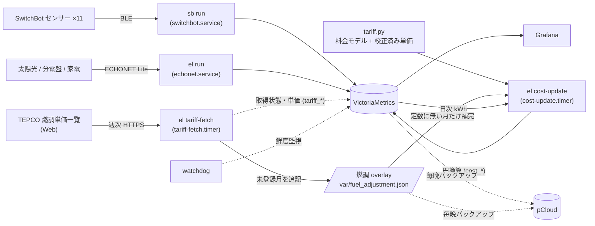

# homeserver

自宅の温湿度・CO2・電力を Raspberry Pi 4 で収集し、VictoriaMetrics に蓄積して Grafana で可視化する
ホームテレメトリシステム。コレクターは2系統あり、電力量からは電気代も算出します:

- **`sb`** — SwitchBot 温湿度/CO2センサー(BLE アドバタイズ直接受信)
- **`el`** — ECHONET Lite 経由の電力系(太陽光発電・分電盤の回路別消費・エアコン・エコキュート)
  と、電気料金の計算(`el cost-update`)・燃料費調整単価の自動取得(`el tariff-fetch`)



## Features
- SwitchBot: BLE アドバタイズを直接デコード(Meter / Meter Plus / CO2 Meter / Hub 2)。
  クラウド非依存・API制限なし。温度+湿度から絶対湿度と温熱快適指標 PMV(ISO 7730、
  着衣量×活動量のシナリオ別)も計算して保存
- ECHONET Lite: 太陽光の瞬時/積算発電、分電盤の主幹(買電/売電)と回路別28chの瞬時電力、
  エアコン(消費電力・積算電力量・室温/湿度・外気温・設定温度/湿度・運転モード)、
  エコキュート(消費電力・残湯量)。AiSEG2 履歴CSVの過去データ一括取込(`el import-history`)にも対応
- 電気料金: TEPCO くらし上手L + 燃料費調整 + 再エネ賦課金 + FIT売電のモデルで、日次・
  検針期間(10日〆)・暦年の請求見込み/自家消費の節約額/売電収入を算出(実請求書を1円単位で
  再現することをテストで担保)。燃調単価の新しい月は週次で TEPCO から自動取得し、
  請求書での校正前でもグラフが止まらない
- 耐障害設計: 連続エラー時のプロセス自己再起動 + データ鮮度 watchdog(詳細は runbook)

## Documentation
- [docs/runbook.md](docs/runbook.md) — 本番環境(ラズパイ4)の構成・障害対応手順・ハマりどころ集
- [docs/incidents/](docs/incidents/) — 障害記録(ポストモーテム)
- [deploy/README.md](deploy/README.md) — systemd ユニット・スクリプト・Grafana 設定の原本と再構築手順
- [AGENTS.md](AGENTS.md) — エージェント向け作業規約(デプロイ・ドキュメント更新の決まり)

## Repository layout

| パス | 内容 |
| --- | --- |
| `src/cli/` | 実装。`sync_data.py` = sb、`switchbot_ble.py` = BLEデコード、`comfort.py` = PMV、`echonet.py` = el、`cost.py` = 料金メトリクス計算、`tariff.py` = 料金モデルと単価テーブル、`tariff_fetch.py` = 燃調の自動取得・検証 |
| `deploy/` | Pi 上の成果物の原本(systemd / スクリプト / Grafana 設定) |
| `docs/` | runbook と障害記録 |
| `scripts/` | 運用スクリプト(`deploy-to-pi.sh`、`health-check.sh`、`gen_comfort_zone.py` = 快適マップのゾーン生成) |
| `.claude/skills/` | Claude Code 用スキル(`/deploy-pi`、`/homeserver-health`) |
| `tests/` | pytest スイート(実機ペイロードと TEPCO 燃調ページのフィクスチャ入り) |
| `var/` | 実行時データ(**git 管理外**)。Pi 上の `var/fuel_adjustment.json` = 自動取得した燃調単価 |

## Requirements
- Python 3.13 or later.
- [uv](https://docs.astral.sh/uv/) for environment management (recommended).
- macOS or Linux with BLE hardware and permissions for BLE mode.

## Setup
1. Install uv if necessary (`pip install uv`) or follow the uv documentation.
2. Install dependencies from the project root: `uv sync`.
3. Create a `.env` file (see below) or export the required environment variables.

## Configuration
These environment variables are read by the CLI (values shown below are examples):

```dotenv
INFLUX_URL=http://localhost:8428
LOCATION_PREFIX=home-
REQUEST_TIMEOUT_S=10
EF_MODEL=none
SWITCHBOT_BLE_DEVICES=B0:E9:FE:54:48:8F@co2=bedroom,F2:B2:02:06:4A:8B@meter=toilet
SWITCHBOT_BLE_SCAN_TIMEOUT=15
ECHONET_DEVICES=192.168.11.10@solar=太陽光,192.168.11.10@powerboard=分電盤,192.168.11.12@aircon=エアコンA
ECHONET_TIMEOUT_S=3
ECHONET_CIRCUIT_NAMES=1=リビング,2=玄関ホール,11=冷蔵庫
ECHONET_CIRCUIT_EXCLUDE=26,28
```

| Variable | Required | Description |
| --- | --- | --- |
| `INFLUX_URL` | yes | Base URL of the line-protocol endpoint (VictoriaMetrics: `http://host:8428`, InfluxDB: `http://host:8086`). |
| `LOCATION_PREFIX` | optional | Prepended to the `location` tag written to Influx. |
| `REQUEST_TIMEOUT_S` | optional | HTTP timeout in seconds (default `10`). |
| `EF_MODEL` | optional | Enhancement factor model for absolute humidity (`none`, `buck`, `its90`). |
| `SWITCHBOT_BLE_DEVICES` | optional | Comma-separated `MAC[@type][=alias]` specs used by `push` and `run`. |
| `SWITCHBOT_BLE_SCAN_TIMEOUT` | optional | BLE scan timeout in seconds (default `5`). |
| `ECHONET_DEVICES` | el のみ | Comma-separated `IP@type[=alias]`。type: `solar` / `powerboard` / `aircon` / `ecocute`。 |
| `ECHONET_TIMEOUT_S` | optional | ECHONET Lite 応答タイムアウト秒(default `3`)。 |
| `ECHONET_CIRCUIT_NAMES` | optional | 分電盤の回路番号→名称(`1=リビング,...`)。`name` タグとして付与。 |
| `ECHONET_CIRCUIT_EXCLUDE` | optional | 収集から除外する回路番号(未使用回路)。 |
| `TARIFF_OVERLAY_PATH` | optional | `el tariff-fetch` が書く燃調単価 overlay の場所(default: リポジトリ直下 `var/fuel_adjustment.json`)。 |

`@type` accepts values such as `meter`, `co2`, `hub2`, or the raw code label (`code_0x35`) if the device is unknown.

## CLI usage
All commands are exposed by the Typer application registered as the `sb` console script. Run them via uv:

```bash
uv run sb --help
```

### push
One-shot data collection and write to InfluxDB.

```bash
uv run sb push --ble-device B0:E9:FE:54:48:8F@co2 --ble-scan-timeout 20
```

- `--ble-device` can be passed multiple times; if omitted, `SWITCHBOT_BLE_DEVICES` is used.

### run
Continuous loop version of `push`.

```bash
uv run sb run --interval 60 --ble-scan-timeout 20
```

The loop catches exceptions, logs them to stdout, and continues. After 5 consecutive failures it exits with a non-zero status so that systemd (`Restart=on-failure`) restarts the process with a fresh BLE/D-Bus session.

### scan-ble
Scans the local BLE radio, identifies SwitchBot advertisements, and infers the device type or model from manufacturer data.

```bash
uv run sb scan-ble --timeout-s 30
```

Output includes `source=switchbot`, inferred `type`, raw `code`, RSSI, and decoded metrics (temperature, humidity, CO2, battery) when available. Non-SwitchBot advertisements are labeled `source=other`.

## Power collection CLI (`el`)
ECHONET Lite (UDP 3610) 経由で太陽光・分電盤(回路別)・エアコン・エコキュートを収集する第2のコレクターです。

```bash
uv run el scan --subnet 192.168.11   # LAN上の ECHONET Lite 機器を発見
uv run el push                        # 1回収集して書き込み
uv run el run --interval 60           # 常駐ループ (echonet.service が使用)
uv run el import-history <dir> --max-day YYYYMMDD   # AiSEG2 履歴CSVの一括取込
uv run el cost-update                 # 日次kWhの実体化と電気料金メトリクスの更新 (cost-update.timer が毎晩実行)
uv run el tariff-fetch [--dry-run]    # TEPCO 燃調単価の自動取得 → overlay 追記 (tariff-fetch.timer が週次実行)
```

対象機器は `ECHONET_DEVICES`(`IP@type[=alias]` のカンマ区切り、type: solar/powerboard/aircon/ecocute)、
回路名は `ECHONET_CIRCUIT_NAMES`、未使用回路の除外は `ECHONET_CIRCUIT_EXCLUDE` で設定します。
詳細は [deploy/README.md](deploy/README.md) と [docs/runbook.md](docs/runbook.md) を参照。

## Raspberry Pi サービス運用

本番構成(VictoriaMetrics + Grafana + コレクター + watchdog + pCloud バックアップ)の
systemd ユニット・スクリプト・Grafana 設定の原本はすべて [deploy/](deploy/) にあり、
配置先マッピングとゼロからの再構築手順は [deploy/README.md](deploy/README.md) にまとめてあります。

要点だけ:

1. リポジトリを `/opt/homeserver` に配置して `uv sync`、`.env` を作成
   (`INFLUX_URL=http://localhost:8428`、`SWITCHBOT_BLE_DEVICES` に全デバイスを列挙)。
   `.env` は systemd の `EnvironmentFile` ではなく CLI 自身(python-dotenv)が読む。
   ユニットに存在しない `EnvironmentFile` を書くと起動即失敗するので注意
   ([docs/incidents/2026-07-05-influxdb-scraper-bloat.md](docs/incidents/2026-07-05-influxdb-scraper-bloat.md) の教訓)。
2. `deploy/systemd/` のユニットと `deploy/bin/` のスクリプトを配置:
   ```bash
   cd /opt/homeserver
   sudo install -m 755 deploy/bin/*.sh /usr/local/bin/
   sudo install -m 644 deploy/systemd/* /etc/systemd/system/
   sudo systemctl daemon-reload
   sudo systemctl enable --now victoria-metrics switchbot collector-watchdog.timer vm-backup.timer
   ```
3. 動作確認:
   ```bash
   journalctl -u switchbot.service -f        # 毎分 "wrote N points" が出る
   systemctl list-timers                     # watchdog / backup タイマー
   ```

watchdog は climate データが 10 分以上更新されない場合に bluetooth と switchbot.service を
自動再起動します(bluetoothd 側の故障はコレクター再起動だけでは直らないため。
経緯は [docs/incidents/2026-07-06-bluetoothd-dbus-outage.md](docs/incidents/2026-07-06-bluetoothd-dbus-outage.md))。
日々の運用・障害対応は [docs/runbook.md](docs/runbook.md) を参照してください。

## Testing
Run the test suite (pytest; the dev dependency group is synced automatically):

```bash
uv run pytest             # tests only
uv run pytest --cov       # with coverage (fails under the floor in pyproject.toml)
```

Existing unittest-style tests run under pytest as-is; write new tests in pytest
style. Coverage settings live in `pyproject.toml` (`[tool.coverage.*]`), with
hardware-bound BLE discovery excluded via `pragma: no cover`. CI
(`.github/workflows/test.yml`) runs the same suite plus shellcheck for
`deploy/bin/*.sh` and `scripts/*.sh` on every push.

## Operations
- デプロイ: `scripts/deploy-to-pi.sh` — main の HEAD を Pi へ同期し、成果物の配置と
  サービス再起動まで自動判定(Claude Code では `/deploy-pi`)
- ヘルスチェック: `scripts/health-check.sh` — サービス・データ鮮度・ディスク・バックアップの
  一括確認(Claude Code では `/homeserver-health`)

## Notes
- BLE decoding currently covers Meter, Meter Plus, CO2 meters (including outdoor versions), and Hub 2 (temperature/humidity only; no battery since it is mains powered). Unrecognized payloads fall back to `type=unknown` with a `code_0x..` label.
- For reliable BLE results, increase `--ble-scan-timeout` or `SWITCHBOT_BLE_SCAN_TIMEOUT`, especially for devices with long advertising intervals.
